# ConnectX Enterprise Database Architecture & Operations Guide

## 1. Entity-Relationship (ER) Diagram

```mermaid
erDiagram
  %% A. USER SYSTEM
  users ||--o| user_profiles : "has profile"
  users ||--o| user_credentials : "has credentials"
  users ||--o| user_privacy_settings : "has privacy"
  users ||--o{ user_devices : "registers"
  users ||--o{ user_sessions : "owns sessions"
  user_devices ||--o{ user_sessions : "binds session"
  users ||--o{ otp_verifications : "verifies"
  users ||--o{ user_key_bundles : "publishes E2EE keys"
  users ||--o{ user_contacts : "owns contacts"
  users ||--o{ user_blocks : "blocks"
  users ||--o{ abuse_reports : "reports"

  %% B. CHAT SYSTEM
  conversations ||--o{ conversation_members : "contains"
  users ||--o{ conversation_members : "participates"
  conversations ||--o{ messages : "stores"
  users ||--o{ messages : "sends"
  messages ||--o{ message_receipts : "tracks delivery/read"
  messages ||--o{ message_reactions : "receives"
  messages ||--o{ message_attachments : "attaches"
  messages ||--o{ message_edits : "logs edits"
  messages ||--o{ message_deletions : "logs deletions"
  conversations ||--o{ pinned_messages : "pins"
  messages ||--o{ pinned_messages : "pinned in"
  messages ||--o{ starred_messages : "starred by"

  %% C. GROUP & D. COMMUNITY SYSTEMS
  conversations ||--o| groups : "backs group chat"
  communities ||--o{ groups : "links"
  communities ||--o{ community_groups : "maps"
  groups ||--o{ community_groups : "belongs to"
  groups ||--o{ group_roles : "defines roles"
  groups ||--o{ group_members : "has members"
  group_roles ||--o{ group_members : "assigns"
  groups ||--o{ group_permissions : "enforces"
  groups ||--o{ group_invites : "issues"
  communities ||--o{ community_members : "has members"
  communities ||--o{ community_announcements : "broadcasts"

  %% E. BUSINESS SYSTEM
  business_categories ||--o{ business_accounts : "categorizes"
  users ||--o| business_accounts : "operates"
  business_accounts ||--o{ business_verifications : "verifies"
  business_accounts ||--o{ business_catalogs : "publishes"
  business_catalogs ||--o{ products : "lists"
  business_accounts ||--o{ products : "owns"
  products ||--o{ product_images : "shows"
  business_accounts ||--o{ customers : "tracks CRM"
  customers ||--o{ customer_notes : "annotates"
  business_accounts ||--o{ customer_labels : "defines tags"
  business_accounts ||--o{ quick_replies : "stores shortcuts"
  business_accounts ||--o{ business_automations : "configures rules"
  business_accounts ||--o{ business_orders : "receives"
  products ||--o{ business_orders : "ordered in"

  %% F. CALLING SYSTEM
  conversations ||--o{ calls : "hosts"
  users ||--o{ calls : "initiates"
  calls ||--o{ call_participants : "includes"
  calls ||--o{ call_events : "records signaling"

  %% G. NOTIFICATION SYSTEM
  users ||--o| notification_preferences : "configures"
  users ||--o{ push_subscriptions : "registers web push"
  users ||--o{ notifications : "receives"
  notifications ||--o{ notification_jobs : "dispatches"

  %% H. ADMIN & I. FEATURE CONTROL SYSTEMS
  users ||--o| admin_users : "elevated to"
  admin_users ||--o{ admin_user_roles : "assigned"
  admin_roles ||--o{ admin_user_roles : "granted to"
  admin_roles ||--o{ admin_role_permissions : "bundles"
  admin_permissions ||--o{ admin_role_permissions : "linked"
  users ||--o{ admin_activity_logs : "audits"
  feature_modules ||--o{ feature_flags : "governs"
  feature_modules ||--o{ feature_dependencies : "depends on"

  %% J. BILLING & K. SYSTEM OPERATIONS
  subscription_plans ||--o{ user_subscriptions : "defines tier"
  users ||--o{ user_subscriptions : "subscribes"
  users ||--o{ payment_transactions : "pays"
  payment_transactions ||--o{ invoices : "generates"
  payment_transactions ||--o{ refunds : "requests"
  users ||--o{ media_objects : "uploads"
  media_objects ||--o{ message_attachments : "referenced by"
  users ||--o{ upload_sessions : "initiates"
  users ||--o{ support_tickets : "submits"
```



---

## 2. Version-Controlled SQL Migrations

All migrations live under `backend/prisma/migrations/` and target **PostgreSQL 16** with `TIMESTAMPTZ(3)` UTC timestamps throughout:

1. **`20261125000000_init/migration.sql`**
   - Creates all PostgreSQL enums (`UserRole`, `PresenceStatus`, `OtpChannel`, `ConversationType`, `ConversationMemberRole`, `MessageType`, `DeliveryStatus`, `CommunityMemberRole`, `CallType`, `CallStatus`, `CallParticipantStatus`, `BusinessVerificationStatus`, `OrderStatus`, `NotificationChannel`, `NotificationDeliveryStatus`, `SubscriptionStatus`, `PaymentStatus`, `InvoiceStatus`, `ApprovalStatus`, `TicketStatus`).
   - Creates all **74 relational tables** spanning Domains A–K with UUID primary keys, strict foreign keys, unique constraints, and `created_at` / `updated_at` UTC timestamps.
   - Enforces database-level invariants:
     - `messages_e2ee_no_plaintext_chk`: `CHECK (NOT ("is_encrypted" = true AND "plaintext_body" IS NOT NULL))` guarantees E2EE messages never store plaintext on the server.
     - `business_orders_arithmetic_chk`: `CHECK ("quantity" > 0 AND "unit_price_cents" >= 0 AND "total_cents" = "quantity" * "unit_price_cents")` guarantees exact deterministic order billing.
2. **`20261125010000_partitioning_indexes_retention/migration.sql`**
   - Adds 32 performance composite/partial/GIN indexes optimized for high-throughput cursor pagination and active record queries.
   - Adds declarative **monthly range partitioning** (`PARTITION BY RANGE ("created_at")`) for `messages_archive_partitioned` and `system_logs_partitioned`, backed by **BRIN** indexes on `created_at`.
   - Defines PL/pgSQL routine `purge_expired_connectx_records()` to deterministically remove expired disappearing messages, stale OTP verifications (>24h past expiry), and expired `idempotency_records`.

### Running Migrations

```bash
# Development (apply pending migrations & regenerate client)
npm --prefix backend run prisma:migrate:dev

# Production / CI deployment (non-interactive, strict checksum verification)
npm --prefix backend run prisma:migrate:deploy
```

---

## 3. ORM Schema & Model-to-Table Mapping

The authoritative ORM schema is `backend/prisma/schema.prisma`. Physical PostgreSQL table names use `snake_case` via `@@map("...")` while Prisma model names preserve clean NestJS service contracts:

| Domain | PostgreSQL Tables (`@@map`) | Key Prisma Models |
| :--- | :--- | :--- |
| **A. User System** | `users`, `user_profiles`, `user_credentials`, `user_sessions`, `user_devices`, `otp_verifications`, `user_privacy_settings`, `user_contacts`, `user_blocks`, `user_key_bundles`, `abuse_reports` | `User`, `UserProfile`, `UserCredential`, `DeviceSession`, `UserDevice`, `OtpVerification`, `UserPrivacySetting`, `Contact`, `UserBlock`, `UserKeyBundle`, `AbuseReport` |
| **B. Chat System** | `conversations`, `conversation_members`, `messages`, `message_receipts`, `message_reactions`, `message_attachments`, `message_edits`, `message_deletions`, `pinned_messages`, `starred_messages`, `messages_archive_partitioned` | `Conversation`, `ConversationMember`, `Message`, `MessageReceipt`, `MessageReaction`, `MessageAttachment`, `MessageEdit`, `MessageDeletion`, `PinnedMessage`, `StarredMessage` |
| **C. Group System** | `groups`, `group_members`, `group_roles`, `group_permissions`, `group_invites` | `Group`, `GroupMember`, `GroupRole`, `GroupPermission`, `GroupInvite` |
| **D. Community System** | `communities`, `community_members`, `community_groups`, `community_announcements` | `Community`, `CommunityMember`, `CommunityGroup`, `CommunityAnnouncement` |
| **E. Business System** | `business_accounts`, `business_verifications`, `business_categories`, `business_catalogs`, `products`, `product_images`, `customers`, `customer_labels`, `customer_notes`, `business_orders`, `quick_replies`, `business_automations` | `BusinessProfile`, `BusinessVerification`, `BusinessCategory`, `BusinessCatalog`, `Product`, `ProductImage`, `CustomerRecord`, `CustomerLabel`, `CustomerNote`, `OrderInquiry`, `QuickReply`, `BusinessAutomation` |
| **F. Calling System** | `calls`, `call_participants`, `call_events` | `CallSession`, `CallParticipant`, `CallEvent` |
| **G. Notification System** | `notifications`, `notification_preferences`, `notification_jobs`, `notification_templates`, `push_subscriptions` | `NotificationRecord`, `NotificationPreference`, `NotificationJob`, `NotificationTemplate`, `PushSubscription` |
| **H. Admin System** | `admin_users`, `admin_roles`, `admin_permissions`, `admin_user_roles`, `admin_role_permissions`, `admin_activity_logs`, `admin_approvals` | `AdminUser`, `CustomAdminRole`, `AdminPermission`, `AdminUserRole`, `AdminRolePermission`, `AdminAuditLog`, `ApprovalWorkflow` |
| **I. Feature Control** | `feature_modules`, `feature_flags`, `feature_dependencies`, `app_settings`, `app_releases` | `FeatureModule`, `FeatureFlag`, `FeatureDependency`, `SystemConfig`, `AppRelease` |
| **J. Billing System** | `subscription_plans`, `user_subscriptions`, `payment_transactions`, `invoices`, `refunds` | `SubscriptionPlan`, `BusinessSubscription`, `PaymentTransaction`, `Invoice`, `RefundRequest` |
| **K. System Operations** | `media_objects`, `upload_sessions`, `support_tickets`, `system_logs`, `system_logs_partitioned`, `backup_records`, `system_announcements`, `idempotency_records` | `MediaObject`, `UploadSession`, `SupportTicket`, `SystemLog`, `BackupRecord`, `SystemAnnouncement`, `IdempotencyRecord` |

---

## 4. Indexing Strategy

1. **Cursor-Based Chat Pagination (Hot Path)**:
   - `messages_cursor_active_idx` on `messages ("conversation_id", "created_at" DESC, "id") WHERE "deleted_at" IS NULL` eliminates `OFFSET` scans and skips soft-deleted messages during timeline fetches.
2. **Partial Active-Record Indexes**:
   - `users_active_presence_idx` (`WHERE deleted_at IS NULL`), `user_sessions_active_idx` (`WHERE revoked_at IS NULL`), `otp_verifications_lookup_idx` (`WHERE consumed_at IS NULL`), `message_receipts_unread_idx` (`WHERE read_at IS NULL`), `notifications_inbox_idx` (`WHERE read_at IS NULL`), and `group_invites_active_idx` (`WHERE revoked_at IS NULL`) keep B-tree footprint minimal for live authentication and unread badge counts.
3. **Array / Tag Filtering (`GIN`)**:
   - `customers_labels_gin_idx` (`USING GIN ("labels")`) enables sub-millisecond CRM segment queries (`labels @> ARRAY['VIP']`).
4. **Time-Series Archive & Telemetry (`BRIN` + Monthly Range Partitions)**:
   - `messages_archive_partitioned` and `system_logs_partitioned` isolate append-only history into monthly partitions (`*_2026_11`, `*_2026_12`, `*_default`) with compact `BRIN` indexes on `created_at` so archival drops require `DROP TABLE` rather than expensive `VACUUM`.

---

## 5. Relationships, Cascading Rules, Transactions & Redis Caching

### Foreign Key Cascading Rules
- **`ON DELETE CASCADE`**: Applied strictly to owned dependent sub-records (`user_profiles`, `user_credentials`, `user_sessions`, `user_devices`, `otp_verifications`, `conversation_members`, `message_receipts`, `message_reactions`, `message_attachments`, `product_images`, `customer_notes`, `call_participants`, `call_events`, `notification_jobs`, `admin_user_roles`, `admin_role_permissions`).
- **`ON DELETE RESTRICT`**: Protects financial and commercial integrity on referenced catalog items and ledger records (`business_orders.product_id -> products.id`, `user_subscriptions.plan_id -> subscription_plans.id`, `invoices.transaction_id -> payment_transactions.id`).
- **`ON DELETE SET NULL`**: Preserves parent auditability when optional links are removed (`users.custom_role_id`, `user_sessions.device_id`, `groups.community_id`, `products.catalog_id`, `calls.conversation_id`, `message_attachments.media_object_id`, `feature_flags.module_id`).

### Transaction Boundaries (`prisma.$transaction`)
- **Refresh Token Rotation & Reuse Detection**: Token verification, reuse-family revocation, and new token-version issuance run atomically in a single DB transaction.
- **Idempotent Billing & Order Creation**: `payment_transactions`, `invoices`, `user_subscriptions`, and `idempotency_records` commit together so Stripe webhook retries cannot double-bill or skip invoice issuance.
- **Disappearing & Retention Sweeps**: `purge_expired_connectx_records()` runs atomically in PL/pgSQL and returns exact row counters for `system_logs` telemetry.

### Redis Cache & State Strategy (Hot Layer)
| Key Pattern | TTL / Structure | Purpose |
| :--- | :--- | :--- |
| `presence:{userId}` | String (`TTL 90s`, refreshed by heartbeat) | Real-time online/away/busy status without hammering PostgreSQL |
| `typing:{conversationId}:{userId}` | String (`TTL 6s`) | Ephemeral typing indicators broadcast over Socket.IO |
| `ratelimit:{route}:{ipOrUser}` | Sliding window (`60s`) | `@nestjs/throttler` / API abuse protection |
| `call:room:{callId}` | Hash (`TTL 14400s`) | Active WebRTC participants & ICE signaling room state |
| `feature:flags` | Hash (`TTL 60s`, invalidated on admin update) | Zero-latency feature flag & maintenance-mode evaluation |

---

## 6. Seed Script (`backend/prisma/seed.ts`)

`prisma/seed.ts` uses idempotent `upsert` operations exclusively for structural reference metadata (zero fake users or fake products):
- **Admin Permissions & Roles**: `users:read`, `users:manage`, `approvals:review`, `system:config`, `system:backup`, `audit:read` + `Compliance Reviewer` role mappings.
- **Business Categories**: `software-saas`, `retail-commerce`, `professional-services`, `logistics-supply`.
- **Feature Modules, Dependencies & Flags**: `messaging_e2ee`, `webrtc_calling`, `e2ee_private_chats`, `group_video_calls`, `disappearing_messages`.
- **App Settings & Releases**: `maintenance_mode`, `retention_policy_days`, Android `2.0.0` baseline release.
- **Notification Templates & Subscription Plans**: `auth.otp.email`, `call.incoming.inapp`, and `STARTER` / `GROWTH` / `ENTERPRISE` pricing tiers.

```bash
npm --prefix backend run db:seed
```

---

## 7. Database Test & Verification Scripts

1. **Automated Jest Schema & DDL Validation (`backend/test/database-schema.spec.ts`)**:
   - Validates every required Domain A–K table is declared in `backend/prisma/schema.prisma` (`@@map`) and created in `20261125000000_init/migration.sql`.
   - Verifies check constraints (`messages_e2ee_no_plaintext_chk`, `business_orders_arithmetic_chk`), declarative range partitions (`messages_archive_partitioned`, `system_logs_partitioned`), `purge_expired_connectx_records()`, zero plaintext password/private-key columns, and zero AI tables.
   - Run: `npm --prefix backend test`
2. **Live PostgreSQL Inspection Script (`backend/prisma/scripts/verify-schema.sql`)**:
   - Inspects `pg_tables`, `pg_constraint`, `pg_inherits` (partitions), and seeded reference counts on a live PostgreSQL instance:
   - Run: `psql "$DATABASE_URL" -v ON_ERROR_STOP=1 -f backend/prisma/scripts/verify-schema.sql`

---

## 8. Backup & Restore Procedures

### PostgreSQL Physical Backup + PITR (WAL Archiving)
1. **Enable continuous WAL archiving** in `postgresql.conf`:
   ```ini
   wal_level = replica
   archive_mode = on
   archive_command = 'test ! -f /backups/wal/%f && cp %p /backups/wal/%f'
   ```
2. **Take base physical backup**:
   ```bash
   pg_basebackup -h "$PGHOST" -U "$PGUSER" -D /backups/base_$(date -u +%Y%m%dT%H%M%SZ) -Ft -z -Xs -P
   ```
3. **Logical Compressed Snapshot + SHA-256 Checksum Registration**:
   ```bash
   DUMP_FILE="/backups/connectx_$(date -u +%Y%m%dT%H%M%SZ).dump"
   pg_dump --format=custom --no-owner --no-privileges "$DATABASE_URL" > "$DUMP_FILE"
   sha256sum "$DUMP_FILE"
   ```
   Every automated or admin-triggered backup logs its `backup_type`, `checksum_sha256`, `size_bytes`, and `triggered_by_id` in `backup_records`.

### PostgreSQL Restore & PITR Drill
```bash
# Logical restore into a clean database
createdb connectx_restore
pg_restore --clean --if-exists --no-owner --no-privileges -d "$RESTORE_DATABASE_URL" "$DUMP_FILE"
psql "$RESTORE_DATABASE_URL" -v ON_ERROR_STOP=1 -f backend/prisma/scripts/verify-schema.sql
```
For Point-in-Time Recovery (PITR), extract the base backup into `PGDATA`, place `recovery.signal`, set `restore_command = 'cp /backups/wal/%f %p'` and `recovery_target_time = '2026-11-25 10:00:00+00'`, and start PostgreSQL.

### Redis Persistence Backup & Restore
- Enable hybrid persistence (`appendonly yes` + `save 900 1 300 10`) in Redis 7.
- Trigger snapshot before maintenance: `redis-cli BGSAVE` and archive `dump.rdb` + `appendonlydir/`.
- Restore by stopping Redis, replacing `dump.rdb`/`appendonlydir/` in `/data`, and restarting the Redis service (`redis-cli PING` -> `PONG`).
